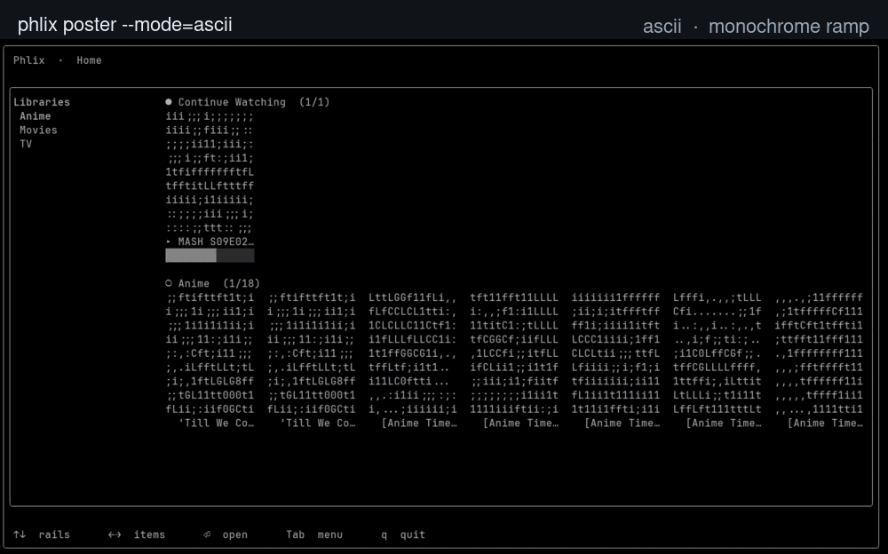
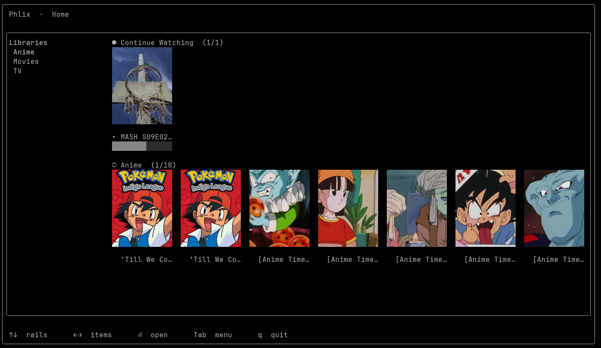
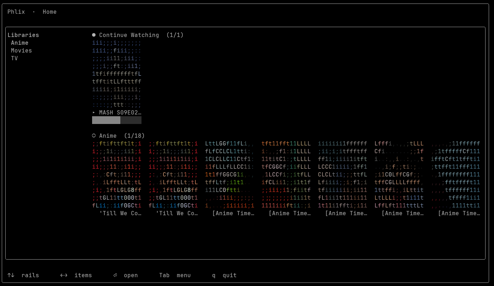
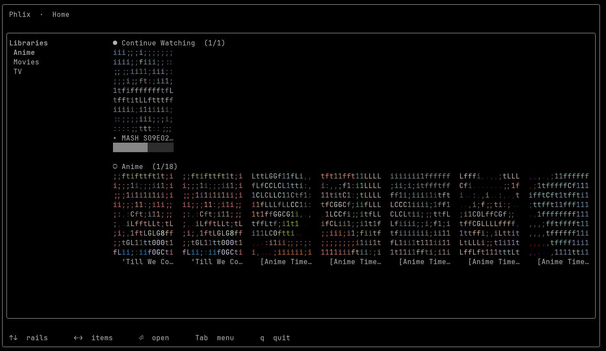
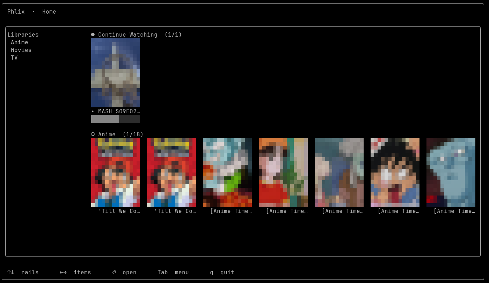
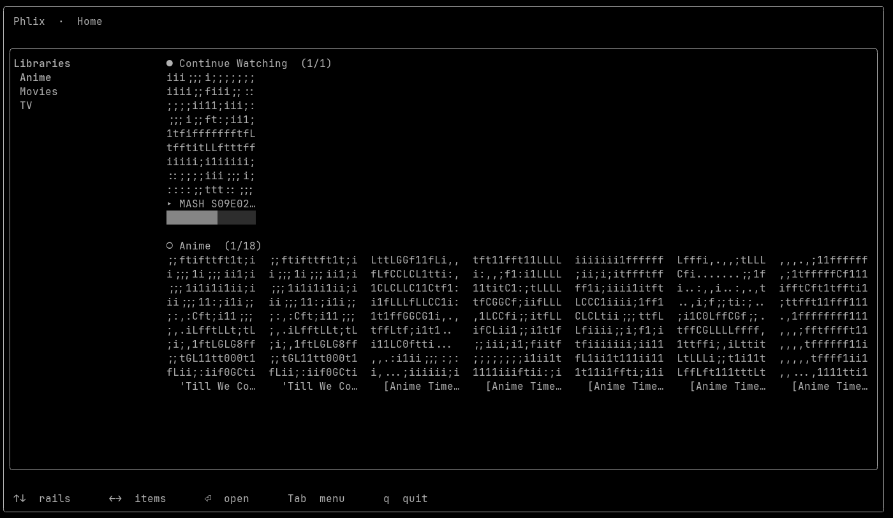

# phlix-console-client

[](https://github.com/detain/phlix-console-client/actions/workflows/ci.yml)
[](https://codecov.io/gh/detain/phlix-console-client)
[](https://github.com/detain/phlix-console-client/releases)
[](LICENSE)
[](https://www.php.net/)

**Phlix is an open-source media server you run yourself** — your own movies,
shows and music on your own hardware, streamed to your devices. The server is a
separate project, [`phlix-server`](https://github.com/detain/phlix-server);
this repository is its full-window **terminal (TUI) client**: browse libraries
as poster rails and virtualized grids, drill media detail and
series → season → episode, open music, book, audiobook and photo libraries in
browsers built for each; global search; a command palette wired to every
screen in the client (its full shipped census is under **Run it** below);
**SyncPlay watch parties**; casting to **Chromecast / Roku / AirPlay / DLNA**;
item **downloads**; a **full admin client** — and an in-terminal video player
that **direct-plays** HEVC/AV1 the browser can't, with **trickplay** sprite
thumbnails previewing while you scrub. Posters and video render as
**sixel / kitty / iTerm2 / half-block ANSI** via the
[SugarCraft](https://sugarcraft.github.io/) stack.

## Documentation

This page is the front door. The full user manual — config-file layout, every
keybinding, the screen-by-screen guide, the render-mode reference and genuine
troubleshooting — lives in **[docs/clients/console.md](docs/clients/console.md)**.
Straight to the answers:

| Question | Jump to |
| --- | --- |
| Where does config live; which files and env vars? | [Configuration](docs/clients/console.md#configuration) |
| What does every key do? | [Keybindings](docs/clients/console.md#keybindings) |
| Which screens exist, and how do I reach each? | [Screens](docs/clients/console.md#screens) |
| How do rating / favorite / watched persist? | [Watching & ratings](docs/clients/console.md#watching--ratings) |
| How do I consume hub-relay play commands headless? | [Hub relay consumer](docs/clients/console.md#hub-relay-consumer-watch) |
| "needs a TTY" / no graphics / expired session? | [Troubleshooting](docs/clients/console.md#troubleshooting) |

Further reading: [i18n](docs/i18n.md) (the env locale chain),
[terminal graphics](docs/terminal-graphics.md) (protocol capabilities),
[upgrade notes](docs/upgrade/v1.md). Issues and questions:
[the issue tracker](https://github.com/detain/phlix-console-client/issues).

## Render modes

The same screen rendered with each `--mode`, cycling every few seconds.
**Graphics** protocols emit a real image (highest fidelity, terminal-dependent);
**cell** modes tile coloured text and work in any terminal, trading detail for
compatibility.



<details>
<summary>Side-by-side stills</summary>

| Mode | Type | Preview |
| --- | --- | --- |
| `sixel` | graphics — sixel protocol |  |
| `iterm2` | graphics — iTerm2 inline images |  |
| `truecolor` | cell — 24-bit colour character ramp |  |
| `ansi256` | cell — 256-colour character ramp |  |
| `quarterblock` | cell — dense 24-bit colour blocks |  |
| `halfblock` (≡ `ansi`) | cell — 24-bit colour half-blocks (universal fallback) |  |
| `ascii` | cell — monochrome character ramp |  |

</details>

> `kitty` is also supported (graphics, kitty protocol) but renders identically to
> the other graphics modes in a capable terminal.

> **Status: Phases 0–10 complete.** Working today: log
> in, browse your libraries as poster rails beside a sidebar, open a library into
> a virtualized poster grid (scroll, filter, sort, A–Z jump), open any poster
> into a **detail screen** (hero poster, metadata, synopsis, and a **Cast** list
> with initials-based ANSI avatars), and drill
> **series → season → episode**, with a **breadcrumb trail** in the header.
>
> Press `p` to launch the **in-terminal player** (Phase 4): it **direct-plays**
> the item's signed stream straight through ffmpeg — decoding HEVC/MKV/AV1 the
> browser can't and bypassing the server transcode — with a **scrubber** (chapter
> ticks + intro/outro skip + **trickplay** sprite thumbnails previewing while
> you drag, where the server publishes them for the item), **resume** from
> where you left off, **progress reporting**, **up-next** auto-advance
> between episodes, on-demand **subtitles**,
> and a **transcode fallback** when a file can't be direct-played.
>
> Phase 5 adds **global search** (`/` from anywhere → a debounced query over a
> virtualized poster grid of `/media?search=` results), a **command palette**
> (Ctrl-K or `:` → fuzzy-ranked actions), and **toasts**
> — transient top-right notifications that surface errors
> which used to fail silently. The palette has since grown into the client's
> universal navigator, registered screen-by-screen in `src/App.php`: **Search**,
> **Home**, **Settings**, **Stats**, **Watch History**, **Favorites**,
> **Photos**, **Music Artists**, **Playlists**, **Collections**, **Servers**,
> **Shared With Me**, **Invite Links**, **Federation Shares**, **Show metrics**
> / **Hide metrics**, **Admin** (offered only while signed in as an admin),
> **Resume playback** / **Pause playback** and **Stop playback** (while a music
> or audiobook session is live), **Log out**, and **Quit** — plus a `Go to
> <library>` jump per library. The same census with what each action opens is
> under **Run it** below and in the manual's [Screens](docs/clients/console.md#screens)
> section.
>
> Phase 6 makes **every library type browsable** and audio + photos fully usable —
> opening a library now routes to a browser built for its type:
>
> - **Music** — an album list (Album · Artist · Year · Tracks) → a track table;
>   Enter **direct-plays** the audio through ffplay/mpv, with `Space` pause and
>   `n`/`p` for the next/previous track. (No server cover art → text-forward.)
> - **Books** — a virtualized cover grid (lazy covers) → a detail screen with the
>   cover, metadata, and a copyable **download URL** (there is no in-terminal
>   reader).
> - **Audiobooks** — a list (Title · Author · Narrator · Duration) → a chapter
>   table; Enter plays a chapter, `r` **resumes** from your saved position, `Space`
>   pauses, and your **progress is saved back to the server**. (Text-forward.)
> - **Photos** — a grid of album covers (by date) → an album's thumbnail grid → a
>   **fullscreen photo** (`←`/`→` prev/next) with an **EXIF panel** (`i`) and an
>   auto-advancing **slideshow** (`s`). Thumbnails and full images render directly
>   from signed URLs.
>
> Phase 7 adds **theming, settings, and polish**: three built-in themes —
> **Nocturne** (default), **Daylight**, and **Midnight** — plus a **Settings**
> screen (reachable from the command palette) for picking the theme and the
> photo-slideshow interval, applied live. A persistent **Now-Playing bar** spans
> every screen so music and audiobook audio keeps playing (and stays controllable)
> as you navigate; the palette also toggles a diagnostic **metrics HUD** overlay
> and opens a read-only **Stats** screen, and lists load behind **animated shimmer
> skeletons**.
>
> Phase 8 adds **full admin parity plus casting** (the **Admin** action appears in
> the command palette only when you're signed in as an admin). It opens an **admin
> menu** with every section wired:
>
> - **Dashboard** — now-playing sessions, storage usage, top users, top media, and
>   recent activity.
> - **Users** — list with a status filter (All / Pending / Active / Disabled) and
>   per-row actions: approve, disable, reject, delete, toggle admin, reset password
>   (the new password is revealed once); `P` opens that user's viewer profiles.
> - **Plugins** — list with enable / disable / uninstall and install-from-URL.
> - **Plugin Updates** — available updates with an auto-update toggle, a catalog
>   channel setting, and a confirmed apply.
> - **Logs** — a file list with a single-file or merged "all logs" tail viewer.
> - **Backup** — list / create / delete / restore / upload-to-S3, plus a backup
>   schedule editor.
> - **Server Settings** — per-key typed editing (bool toggles inline; int / float /
>   string / JSON via a validated input).
> - **Transcoding** — read-only hardware-accelerator introspection plus editable
>   HDR tone-mapping settings.
> - **Libraries** — scan / rescan / match-metadata with a live scan-status readout.
> - **DLNA server** — status with start / stop.
> - **Remote Access** — Hub, subdomain, relay, and port-forward status with their
>   toggles, plus an in-console Hub **pairing wizard**.
> - **Live TV** — five tabbed sections (Tuners · Channels · Guide · Recordings ·
>   Series Rules) with list + simple actions (create / edit are deferred to the web
>   admin).
> - **Parental Controls** — per-profile tags, access schedules, and stream limits.
> - **Metrics** — read-only snapshot / history / connections / routes panels.
> - **Watch History** — every user's recently-watched items with an optional
>   filter-by-user.
> - **Duplicates** — duplicate groups per library, with an armed merge.
> - **Webhooks** — subscriptions with their URL, events, and enabled status.
> - **Auth Providers** — OIDC / LDAP / GitHub providers with enable / disable and a
>   per-provider settings form.
> - **Server Restart** — a graceful worker reload, confirmed by the server's own
>   ack (no polling).
> - **Filesystem** — a navigable listing of the server's configured browse roots
>   and their subdirectories.
>
> **Cast** is not an admin section — press `C` on a media **detail** screen to
> discover **Chromecast / Roku / AirPlay / DLNA** devices on the network, send the
> item, and drive a transport overlay (pause / resume / stop). Seek is intentionally
> omitted — the cast backends don't expose a uniform playback position.
>
> Also working today, inside the player: `a`, shift-`S` and shift-`C` open the
> **track pickers** — the audio, subtitle (with an explicit Off) and chapter
> tracks the item exposes; picking a chapter jumps to it, and picking a subtitle
> turns the caption overlay on. `v` selects the playback **quality** of a
> transcoded item, and `w` opens **"For You"** recommendations without leaving
> playback. `y` opens the **SyncPlay watch party** modal — create your own room
> (public or private) or join one the server lists; while you are in a room an
> overlay tracks the room, its member count and the sync status, and the room's
> play / pause / seek commands drive your player in step. `z` sets an in-player
> **sleep timer** (presets 15 / 30 / 45 / 60 / 90 / 120 min; playback pauses
> when the countdown expires, and the last preset you used is remembered).

## Requirements

- **A running Phlix media server** — without one this client has nothing to
  connect to. The server is a separate project you run yourself:
  [`phlix-server`](https://github.com/detain/phlix-server).
- **PHP ≥ 8.3** with `ext-gd` (image decode), `ext-mbstring` (multibyte text
  width — src/ and sugar-image), `ext-intl` (sugar-core), `ext-ffi` (PTY
  control via sugar-pty) and `ext-json` (required by workerman; bundled in
  PHP ≥ 8.0). Composer enforces all five at install.
- `ext-curl` — only the `doctor` / `run --selftest` server-reachability probes
  call it; the TUI itself needs no curl.
- `pcntl` + `posix` are **optional**: SugarCraft enables Ctrl-Z suspend with
  them where present and one fork-based test self-skips without them — raw
  mode itself is plain `stty`, no extension needed.
- **ffmpeg** + **ffprobe** (video decode + frame grabs).
- **ffplay** or **mpv** (audio playback — video, music, audiobooks).
- A terminal with **sixel** or the **kitty**/**iTerm2** graphics protocol is
  recommended; **half-block** is the universal fallback.

## Install

### Composer (developer)

The fully verified install path — clone over HTTPS (no SSH key needed) and run
from the checkout:

```sh
git clone https://github.com/detain/phlix-console-client.git
cd phlix-console-client
composer install
bin/phlix run    # needs a real TTY; first run asks for your server URL
```

The SugarCraft libraries are normal Composer dependencies, pulled from
Packagist (`sugarcraft/*`, currently tracking `dev-master`).

### PHAR (end user)

CI publishes a **rolling pre-built PHAR** of the tip of `master` on every push,
carried as an asset of the GitHub Release tagged `latest` — marked
**prerelease**. No stable, versioned release has been cut yet (no `v*.*.*`
tag exists), and GitHub's `/releases/latest` shortlink deliberately excludes
prereleases, so `releases/latest/download/...` URLs **404** today. Download
from the `latest` **tag** path instead (the commands below are verified against
the live release):

```sh
# Download the rolling master-build PHAR (tag path — not releases/latest)
curl -fsSL https://github.com/detain/phlix-console-client/releases/download/latest/phlix.phar -o phlix.phar

# Make it executable
chmod +x phlix.phar

# Run it (first run will prompt for server URL)
./phlix.phar run

# Or add it to your PATH
sudo mv phlix.phar /usr/local/bin/phlix
phlix run
```

**Verify the download** (recommended):
```sh
# Fetch the checksums file (the asset is named SHA256SUMS, no .txt)
curl -fsSL https://github.com/detain/phlix-console-client/releases/download/latest/SHA256SUMS -o SHA256SUMS

# Verify (Linux; on macOS use `shasum -a 256 -c SHA256SUMS`)
sha256sum -c SHA256SUMS
```

**Requirements for PHAR:**
- PHP ≥ 8.3 with `ext-gd`, `ext-mbstring`, `ext-intl`, `ext-ffi`, `ext-json`
  (a PHAR runs without composer's platform check, so these are on you; add
  `ext-curl` for the `doctor` / `run --selftest` reachability probes)
- A terminal with sixel/kitty/iTerm2 support (or use `--mode=halfblock` as fallback)
- ffmpeg + ffprobe (for video frame grabs)

To build your own PHAR from source (`humbug/box` is already a declared dev
dependency and `scripts/build-phar.sh` auto-detects `vendor/bin/box`, so no
separate box install step is needed):

```sh
composer install
./scripts/build-phar.sh

# Output: build/phlix.phar
# Building needs phar.readonly=0 (CI sets it); box reports a clear error
# if your PHP has it enabled.
```

### Developing against unreleased library changes

To test the client against local, unmerged SugarCraft changes, add a path
repository **without committing it**:

```sh
composer config repositories.sugarcraft path '../../sugarcraft/*'
composer update 'sugarcraft/*'
# revert before committing:  git checkout composer.json
```

## Run it

```sh
# Launch the full-window app (needs a real TTY): first run asks for your server
# URL, then log in. Browse rails + sidebar → open a library → grid → open a
# poster → detail → drill series/season/episode. Opening a music, book,
# audiobook, or photo library routes to its own browser instead (album list /
# book grid / audiobook list / photo albums). Press `/` to search and Ctrl-K
# (or `:`) for the command palette from anywhere. Esc walks back; Ctrl-C quits.
bin/phlix run
```

Keys: `↑↓←→` move · `⏎` open · `/` search (or filter, in a grid) · Ctrl-K / `:`
command palette · A–Z jump · `p` play · `C` cast (on a detail screen) · `d`
download (on a detail screen) · `Tab` switch focus on the home screen · `Esc`
back · `Ctrl-C` quit.

**Watch state** — on a media detail screen: `r` rate (a star picker, 1–5 stars =
ratings 2–10), `F` favorite, `w` watched, `l` / `j` thumbs up / down (every one
of these persists to your account on the server, and the screen reverts if the
save fails); on home, `a` cycles the watch filter
All → Watched → Unwatched → ♥ Favorites, and `H` / `P` open your watch history
and playlists. The manual's [Watching & ratings](docs/clients/console.md#watching--ratings)
section covers the loop in full.

The command palette (`Ctrl-K` or `:`) is the universal navigator: **Search**,
**Home**, **Settings** (theme + slideshow interval), the read-only **Stats**
screen, **Watch History**, **Favorites**, **Photos**, **Music Artists**,
**Playlists**, **Collections**, **Servers**, **Shared With Me**, **Invite
Links**, **Federation Shares**, **Show metrics** / **Hide metrics**, **Log out**,
**Quit** — plus a `Go to <library>` jump per library, the **Admin** menu
when you're signed in as an admin (see *Status* above), and **Resume
playback** / **Pause playback** and **Stop playback** while a music or
audiobook session is live. Every live screen is listed with how to reach
it in the manual's [Screens](docs/clients/console.md#screens) section.

**In the player:** `Space` play/pause · `←`/`→` seek ±10s · `0`–`9` seek to % ·
`[` / `]` speed · `m` cycle render mode · `s` skip intro/outro · `o` start over ·
`c` captions · `a` audio-track picker (when the item exposes audio tracks) ·
`S` subtitle-track picker (shift; when the item has subtitle tracks — `s`
stays skip intro/outro) · `C` chapter picker (shift; when the item has
chapters — `c` stays captions) · `v` quality (only shown when the active
transcode advertises an ABR ladder — direct-play and legacy items skip it) ·
`n` / `p` next / previous episode · `w` "For You" recommendations ·
`y` SyncPlay room (create/join) · `z` sleep timer (pause playback after a
15–120 min preset) · `f` toggle chrome · `q`/`Esc` back. Transport keys are
inert until the stream is up (`q`/`Esc` always close the player); while a
picker or modal is open it captures every keystroke (`↑`/`↓` move, `Enter`
picks, `q`/`Esc` dismisses).

**Cast** — on a media **detail** screen, `C` opens a device picker (Chromecast /
Roku / AirPlay / DLNA discovered on the network); pick one to send the item, then
drive a transport overlay (`Space` pause/resume, `x` stop, `Esc` back). Seek is
omitted by design (no uniform position across the cast backends).

**Music** — an album list → a track table; `⏎` plays a track (`Space` pause,
`n`/`p` next/previous). **Audiobooks** — a list → a chapter table; `⏎` plays a
chapter, `r` resumes from your saved spot, `Space` pauses (progress is saved
back). **Books** — a cover grid → a detail screen with a copyable download URL.
**Photos** — album covers (by date) → an album's thumbnails → a fullscreen photo
(`←`/`→` prev/next, `i` EXIF panel, `s` slideshow).

### Render diagnostics

```sh
# What can this terminal render?
bin/phlix doctor

# Render an image at 40 cells wide (best available protocol)
bin/phlix poster /path/to/poster.jpg 40
bin/phlix poster /path/to/poster.jpg 40 --mode=halfblock   # force a mode

# Decode the first 3 frames of a video to ANSI (ffmpeg)
bin/phlix frame /path/to/movie.mkv 3 60 20
```

`doctor`, `poster`, and `frame` are non-interactive and work over a pipe;
`run` needs an interactive terminal. The full command inventory is `run`,
`doctor`, `poster`, `frame`, `watch` (below), `version` (`-V` / `--version`)
and `help` — the latter two print and exit, no terminal required.

### Hub relay watch

```sh
# Consume the hub relay's "play this" commands (headless — no TTY needed)
bin/phlix watch --hub https://hub.example --server-id srv-7 \
    --hub-token-stdin < /run/secrets/hub_token

# Fully env-driven — the recommended carrier for tokens
PHLIX_HUB_URL=https://hub.example PHLIX_HUB_SERVER_ID=srv-7 \
PHLIX_HUB_TOKEN="$TOKEN" bin/phlix watch --once --timeout 60
```

`watch` connects to the hub's SyncPlay relay (`ws(s)://{hub}:8804/syncplay/{server_id}`)
and dispatches every delivered `play_media` command to the player. Four environment
variables drive it — `PHLIX_HUB_URL`, `PHLIX_HUB_SERVER_ID`, `PHLIX_HUB_TOKEN` (a hub
user access token, exchanged for a relay token on each connect) and `PHLIX_RELAY_TOKEN`
(a ready-made relay token; skips minting) — each overridden by its flag (`--hub`,
`--server-id`, `--hub-token`, `--relay-token`). For the two token values prefer the
environment or `--hub-token-stdin` / `--relay-token-stdin`: literal argv secrets are
world-readable via `ps(1)`, so the plain-token flags are deprecated and warn on every
use. `--once` waits for a single play command and exits, giving up after `--timeout`
seconds (default 30). Exit codes: 0 = a command was dispatched (with `--once`, also on
a clean run), 1 = watch failed, 2 = usage error.

## Test

```sh
vendor/bin/phpunit   # or: composer test
```

The video-decode test self-skips when `ffmpeg` is unavailable; the poster test
synthesizes its own image with `gd`, so the suite needs no fixtures.

## Static analysis

`src/` is checked with **PHPStan at level 9** (its strictest level), enforced in
CI — any new type error fails the build. Config lives in `phpstan.neon`;
`tests/` is analysed separately at level 2 via `phpstan-tests.neon`. There is
**no baseline file and no `ignoreErrors`** in either config; the honest
qualifier is that `src/` carries **3 inline suppressions**, all
`@phpstan-ignore-next-line property.onlyWritten`, each on a deliberately
write-only field (`tests/Docs/StaticAnalysisClaimsDocsTest.php` re-derives
this census from the tree — plant or remove a suppression and the table must
move with it; two former `SyncPlayModal` terminal-size rows retired when the
opaque-frame graft made those fields read):

| Site | Why it stays write-only |
| --- | --- |
| `SyncPlayService::$playbackPosition` | room-reported position ingested from group state; the player drives its own clock and never reads it back |
| `SyncPlayService::$currentMediaId` | sanitized group-state mirror — the ingest boundary stores every hostile wire string uniformly, display reader or not |
| `SyncPlayService::$onMemberLeft` | callback registered by the player screen but never dispatched yet — member-left frames have no routing in the service (live gap, owed a code fix) |

```sh
composer phpstan                                    # or: vendor/bin/phpstan analyse
vendor/bin/phpstan analyse -c phpstan-tests.neon    # tests/ at level 2
composer cs                                         # phpcs over src/ and tests/ (composer cs:fix autofixes)
```

## License

MIT
