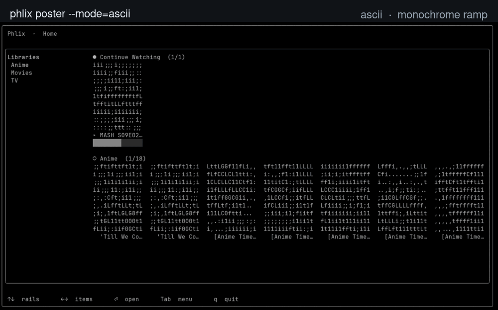
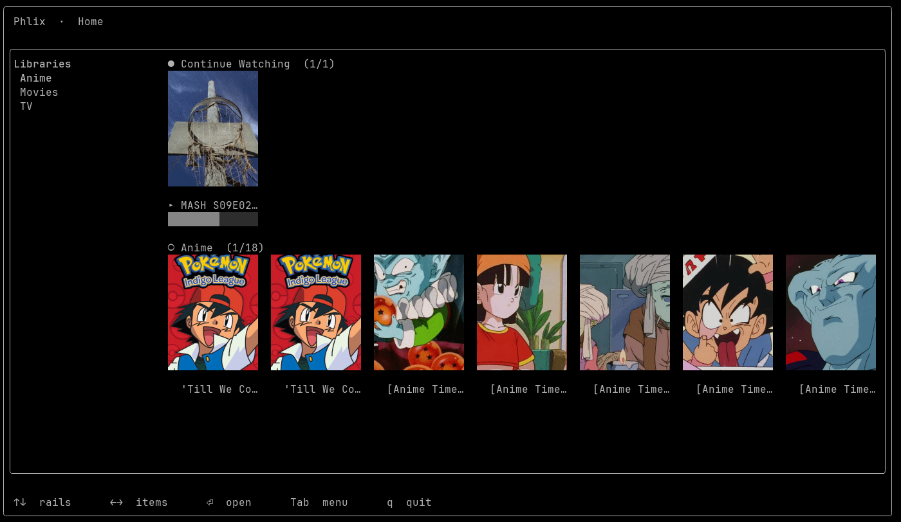
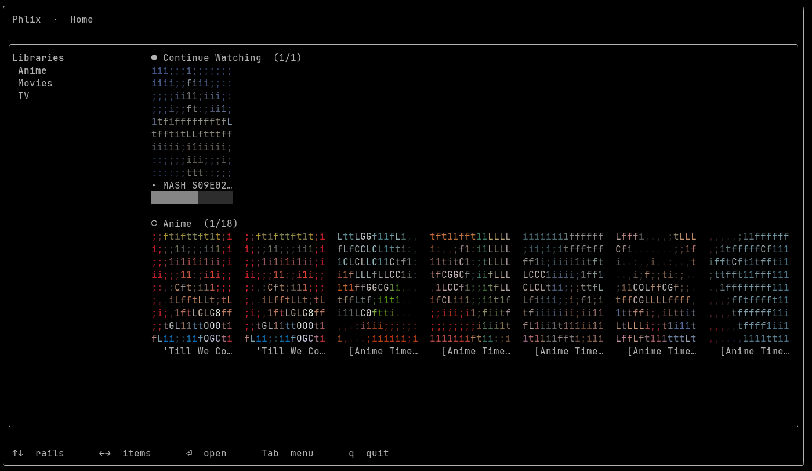
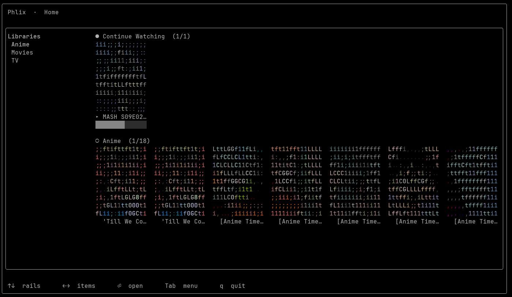
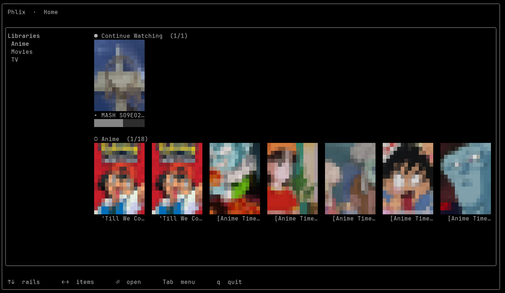
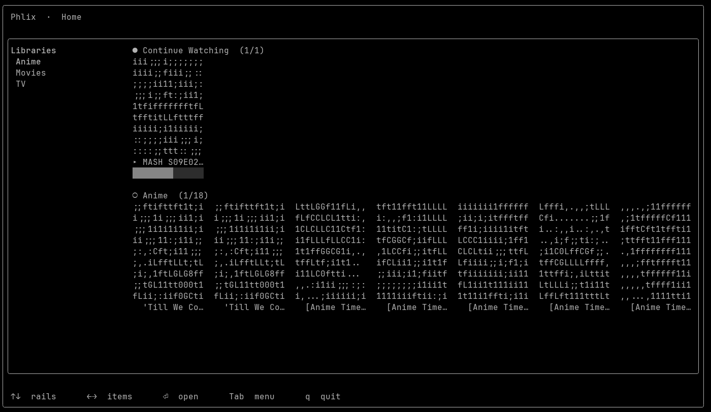

# phlix-console-client

[](https://github.com/detain/phlix-console-client/actions/workflows/ci.yml)
[](https://github.com/detain/phlix-console-client/releases)
[](LICENSE)
[](https://www.php.net/)

**Phlix is an open-source media server you run yourself** — your own movies,
shows and music on your own hardware, streamed to your devices. The server is a
separate project, [`phlix-server`](https://github.com/detain/phlix-server), and
you need one running before this client can do anything. This repository is its
full-window **terminal (TUI) client**: the whole library, browsed and played
from any terminal — over SSH if you like.

What it does once connected:

- **Browse** — libraries as poster rails and virtualized grids; media detail
  and series → season → episode drill-down; music, book, audiobook and photo
  libraries open in browsers built for each; global search.
- **Watch together** — **SyncPlay watch party** rooms, casting to
  **Chromecast / Roku / AirPlay / DLNA**, and item **downloads**.
- **Play in the terminal** — an in-terminal video player that **direct-plays**
  HEVC/AV1 the browser can't, with **trickplay** sprite thumbnails previewing
  while you scrub; posters and video render as **sixel / kitty / iTerm2 /
  half-block ANSI** via the [SugarCraft](https://sugarcraft.github.io/) stack.
- **Stay in control** — a **command palette** wired to every screen in the
  client (the full screen-by-screen list lives in the manual's
  [Screens section](docs/clients/console.md#screens)), and a **full admin
  client** for server upkeep.

The command palette is the one keypress to all of it — **Search**, **Home**,
**Settings**, **Watch History**, **Favorites**, **Photos**,
**Music Artists**, **Playlists**, **Collections**, **Servers**,
**Shared With Me**, **Invite Links**, **Federation Shares**,
**Show metrics** / **Hide metrics**, **Stats** and **Admin** (admins only —
Stats reads the admin stats API),
**Resume playback** / **Pause playback** / **Stop playback** (while a
music or audiobook session is live), **Sign out** and **Quit** — plus a
**Go to <library>** jump per library.



*The same screen rendered with each `--mode`, cycling every few seconds —
the modes are compared side by side under [Render modes](#render-modes).*

## Documentation

This page is the front door. The full user manual — config-file layout, every
keybinding, the screen-by-screen guide, the render-mode reference and genuine
troubleshooting — lives in **[docs/clients/console.md](docs/clients/console.md)**.
Straight to the answers:

| Question | Jump to |
| --- | --- |
| Where does config live; which files and env vars? | [Configuration](docs/clients/console.md#configuration) |
| What does every key do? | [Keybindings](docs/clients/console.md#keybindings) |
| Which screens exist, and how do I reach each? | [Screens](docs/clients/console.md#screens) |
| How do rating / favorite / watched persist? | [Watching & ratings](docs/clients/console.md#watching--ratings) |
| How do I consume hub-relay play commands headless? | [Hub relay consumer](docs/clients/console.md#hub-relay-consumer-watch) |
| "needs a TTY" / no graphics / expired session? | [Troubleshooting](docs/clients/console.md#troubleshooting) |
| Which languages does the interface speak? | [Languages](docs/clients/console.md#languages) |
| `NO_COLOR`, `TERM=dumb`, tiny or basic terminal? | [Accessibility and basic terminals](docs/clients/console.md#accessibility-and-basic-terminals) |

Further reading: [the full manual](docs/clients/console.md) (keys, screens,
configuration), [i18n](docs/i18n.md) (the env locale chain),
[terminal graphics](docs/terminal-graphics.md) (protocol capabilities),
[upgrade notes](docs/upgrade/v1.md),
[development guide](docs/dev/client-console.md) (architecture and gates),
[CI gates](docs/steps/ci-baseline-C9.md) (what must stay green),
[vendor-patch policy](docs/vendor-patches.md),
[dependency policy](docs/dev/dependencies.md).
Issues and questions:
[the issue tracker](https://github.com/detain/phlix-console-client/issues).

## Requirements

- **A running Phlix media server** — without one this client has nothing to
  connect to. The server is a separate project you run yourself:
  [`phlix-server`](https://github.com/detain/phlix-server).
- **PHP ≥ 8.3** with `ext-gd` (image decode), `ext-mbstring` (multibyte text
  width — src/ and sugar-image), `ext-intl` (sugar-core), `ext-ffi` (PTY
  control via sugar-pty), `ext-json` (required by workerman; bundled in
  PHP ≥ 8.0) and `ext-pcntl` (the exit-signal teardown that stops
  ffplay/ffmpeg children on `kill` or a closed terminal, plus Ctrl-Z
  suspend). Composer enforces all six at install. `ext-ffi` is not
  peripheral: sugar-pty drives the terminal through it, so a lean PHP build
  without it hard-fails `composer install` at the platform check — and inside
  a PHAR (which skips that check) the client dies at boot.
- `ext-curl` — the `doctor` / `run --selftest` server-reachability probes and
  `watch`'s hub relay-token mint call it; the TUI itself needs no curl.
- `ext-pcntl` is composer-enforced (soft only in PHAR): every pcntl call is
  `function_exists()`-guarded, so a PHAR on a PHP without it still runs but
  loses the exit-signal teardown and Ctrl-Z suspend. Raw mode itself is plain
  `stty`, no extension needed.
- `posix` is **optional**: Ctrl-Z suspend needs it too, and two fork-based
  tests self-skip without it.
- **ffmpeg** + **ffprobe** (video decode + frame grabs).
- **ffplay** or **mpv** (audio playback — video, music, audiobooks).
- A terminal with **sixel** or the **kitty**/**iTerm2** graphics protocol is
  recommended; **half-block** is the universal colour fallback (any UTF-8
  locale renders it — the UI's glyphs assume UTF-8 throughout).

## Install

### Composer (developer)

The fully verified install path — clone over HTTPS (no SSH key needed) and run
from the checkout:

```sh
git clone https://github.com/detain/phlix-console-client.git
cd phlix-console-client
composer install
bin/phlix run    # needs a real TTY; first run asks for your server URL
```

The SugarCraft libraries are normal Composer dependencies, pulled from
Packagist (`sugarcraft/*`, currently tracking `dev-master`).

### PHAR (end user)

CI publishes a **rolling pre-built PHAR** of the tip of `master` on every push,
carried as an asset of the GitHub Release tagged `latest` — marked
**prerelease**. No stable, versioned release has been cut yet (no `v*.*.*`
tag exists), and GitHub's `/releases/latest` shortlink deliberately excludes
prereleases, so `releases/latest/download/...` URLs **404** today. Download
from the `latest` **tag** path instead (the commands below are verified against
the live release):

```sh
# Download the rolling master-build PHAR (tag path — not releases/latest)
curl -fsSL https://github.com/detain/phlix-console-client/releases/download/latest/phlix.phar -o phlix.phar

# Make it executable
chmod +x phlix.phar

# Run it (first run will prompt for server URL)
./phlix.phar run

# Or add it to your PATH
sudo mv phlix.phar /usr/local/bin/phlix
phlix run
```

**Verify the download** (recommended):
```sh
# Fetch the checksums file (the asset is named SHA256SUMS, no .txt)
curl -fsSL https://github.com/detain/phlix-console-client/releases/download/latest/SHA256SUMS -o SHA256SUMS

# Verify (Linux; on macOS use `shasum -a 256 -c SHA256SUMS`)
sha256sum -c SHA256SUMS
```

**Requirements for PHAR:**
- PHP ≥ 8.3 with `ext-gd`, `ext-mbstring`, `ext-intl`, `ext-ffi`, `ext-json`
  (a PHAR runs without composer's platform check, so these are on you; add
  `ext-curl` for the `doctor` / `run --selftest` reachability probes and
  `watch`'s hub relay-token mint). `ext-pcntl` is composer-enforced (soft
  only in PHAR): without it the PHAR still runs, minus the exit-signal
  teardown and Ctrl-Z suspend. `posix` is optional (Ctrl-Z suspend wants it
  too)
- A terminal with sixel/kitty/iTerm2 support (or use `--mode=halfblock` as fallback)
- ffmpeg + ffprobe (for video frame grabs)
- ffplay or mpv (audio playback — video, music, audiobooks)

To build your own PHAR from source (`humbug/box` is already a declared dev
dependency and `scripts/build-phar.sh` auto-detects `vendor/bin/box`, so no
separate box install step is needed):

```sh
composer install
./scripts/build-phar.sh

# Output: build/phlix.phar
# Building needs phar.readonly=0 (CI sets it); box reports a clear error
# if your PHP has it enabled.
```

### Developing against unreleased library changes

To test the client against local, unmerged SugarCraft changes, add a path
repository **without committing it**:

```sh
composer config repositories.sugarcraft path '../../sugarcraft/*'
composer update 'sugarcraft/*'
# revert before committing:  git checkout composer.json
```

Below, examples are written `bin/phlix …` — the checkout layout. Once you have
installed the PHAR on your PATH, the same commands run as `phlix …`.

## Run it

```sh
# Launch the full-window app (needs a real TTY): first run asks for your server
# URL, then sign in. No account yet? Press `s` at the sign-in form to register
# in place when the server allows sign-ups (a server that approves accounts
# reports yours as pending; an admin can also create one). Browse rails +
# sidebar → open a library → grid → open a
# poster → detail → drill series/season/episode. Opening a music, book,
# audiobook, or photo library routes to its own browser instead (album list /
# book grid / audiobook list / photo albums). Press `/` to search and Ctrl-K
# (or `:`) for the command palette — both once you're signed in (until then
# they type as characters in the sign-in form). Esc walks back; Ctrl-C quits.
bin/phlix run
```

Keys: `↑↓←→` move · `⏎` open · `/` search (or filter, in a grid) · Ctrl-K / `:`
command palette · A–Z jump · `PgUp` / `PgDn` page a grid · `Home` / `End` jump to
a grid's first / last item · `p` play · `C` cast (on a detail screen) · `d`
download (on a detail screen) · `R` refresh (home rails / library grids) · `s`
shuffle-play the focused item (home rails / library grids / media detail) · `c` clear the grid
filter · `u` / `n` jump to the Up Next rail (home) · `[` / `]` page the Most
Watched rail (home) · `q` quit the home browse view · `H` history, `P` playlists
and the `a` watch filter on the home sidebar · `Tab` switch focus on the
home screen · `Esc` back · `Ctrl-C` quit. `/` and the palette are
signed-in keys: until you sign in they type as characters into the sign-in
and server-pick forms.

**Watch state** — on a media detail screen: `r` rate (a star picker, 1–5 stars =
ratings 2–10), `F` favorite, `w` watched, `l` / `j` thumbs up / down (every one
of these persists to your account on the server, and the screen reverts if the
save fails); on home, `a` cycles the watch filter
All → Watched → Unwatched → ♥ Favorites, and `H` / `P` open your watch history
and playlists. The manual's [Watching & ratings](docs/clients/console.md#watching--ratings)
section covers the loop in full.

The command palette (`Ctrl-K` or `:`) is the universal navigator: **Search**,
**Home**, **Settings** (theme + slideshow interval), **Watch History**,
**Favorites**, **Photos**, **Music Artists**,
**Playlists**, **Collections**, **Servers**, **Shared With Me**, **Invite
Links**, **Federation Shares**, **Show metrics** / **Hide metrics**, **Sign out**,
**Quit** — plus a `Go to <library>` jump per library, the read-only **Stats**
screen and the **Admin** menu
when you're signed in as an admin (see *Status* below), and **Resume
playback** / **Pause playback** and **Stop playback** while a music or
audiobook session is live. Every live screen is listed with how to reach
it in the manual's [Screens](docs/clients/console.md#screens) section.

**In the player:** `Space` play/pause · `←`/`→` seek ±10s · `0`–`9` seek to % ·
`[` / `]` speed · `m` cycle render mode · `s` skip intro/outro · `o` start over ·
`c` captions · `a` audio-track picker (when the item exposes audio tracks) ·
`S` subtitle-track picker (shift; when the item has subtitle tracks — `s`
stays skip intro/outro) · `C` chapter picker (shift; when the item has
chapters — `c` stays captions) · `v` quality (only shown when the active
transcode advertises an ABR ladder — direct-play and legacy items skip it) ·
`n` / `p` next / previous episode · `w` "For You" recommendations ·
`y` SyncPlay room (create/join) · `z` sleep timer (pause playback after a
15–120 min preset) · `f` toggle chrome · `q`/`Esc` back. Transport keys are
inert until the stream is up (`q`/`Esc` always close the player); while a
picker or modal is open it captures every keystroke (`↑`/`↓` move, `Enter`
picks, `q`/`Esc` dismisses).

**Cast** — on a media **detail** screen, `C` opens a device picker (Chromecast /
Roku / AirPlay / DLNA discovered on the network); pick one to send the item, then
drive a transport overlay (`Space` pause/resume, `x` stop, `Esc` back). Seek is
capability-gated: `←`/`→` step ∓10 s (`Shift`+arrow: ∓60 s) when the device
exposes its playback position (Chromecast and DLNA do; AirPlay and Roku don't —
there the arrows stay inert and the on-screen hint omits them).

**Music** — an album list → a track table; `⏎` plays a track (`Space` pause,
`n`/`p` next/previous). **Audiobooks** — a list → a chapter table; `⏎` plays a
chapter, `r` resumes from your saved spot, `Space` pauses (progress is saved
back). **Books** — a cover grid → a detail screen with a copyable download URL.
**Photos** — album covers (by date) → an album's thumbnails → a fullscreen photo
(`←`/`→` prev/next, `i` EXIF panel, `s` slideshow).

### Render diagnostics

```sh
# What can this terminal render?
bin/phlix doctor

# Render an image at 40 cells wide (safe cell renderer by default)
bin/phlix poster /path/to/poster.jpg 40
bin/phlix poster /path/to/poster.jpg 40 --mode=halfblock   # …or force any mode

# Decode the first 3 frames of a video to ANSI (ffmpeg)
bin/phlix frame /path/to/movie.mkv 3 60 20
```

`doctor`, `poster`, and `frame` are non-interactive and work over a pipe;
`run` needs an interactive terminal — `run --selftest` is the headless wiring
ladder and does not. The full command inventory is `run`,
`doctor`, `poster`, `frame`, `watch` (below), `version` (`-V` / `--version`)
and `help` (`-h` / `--help`) — the latter two print and exit, no terminal required.

### Hub relay watch

```sh
# Consume the hub relay's "play this" commands (headless — no TTY needed)
bin/phlix watch --hub https://hub.example --server-id srv-7 \
    --hub-token-stdin < /run/secrets/hub_token

# Fully env-driven — the recommended carrier for tokens
PHLIX_HUB_URL=https://hub.example PHLIX_HUB_SERVER_ID=srv-7 \
PHLIX_HUB_TOKEN="$TOKEN" bin/phlix watch --once --timeout 60
```

`watch` connects to the hub's SyncPlay relay (`ws(s)://{hub}:8804/syncplay/{server_id}`)
and dispatches every delivered `play_media` command to the player. Four environment
variables drive it — `PHLIX_HUB_URL`, `PHLIX_HUB_SERVER_ID`, `PHLIX_HUB_TOKEN` (a hub
user access token, exchanged for a relay token on each connect) and `PHLIX_RELAY_TOKEN`
(a ready-made relay token; skips minting) — each overridden by its flag (`--hub`,
`--server-id`). The `--server-id` value is the
hub's own identifier for your server — assigned when the server pairs with the
hub; `GET /api/v1/me/servers` on the hub lists the ids of the servers on your
account (the hub web portal's My Servers view shows the same), and `watch`
mints its short-lived relay token against `POST /api/v1/me/servers/{id}/relay-token`.
For the two token values prefer the
environment or `--hub-token-stdin` / `--relay-token-stdin`: literal argv secrets are
world-readable via `ps(1)`, so the literal `--hub-token` / `--relay-token` flags were
removed and now exit 2 with a migration hint. `--once` waits for a single play command
and exits, giving up after `--timeout`
seconds (default 30). Exit codes: 0 = a command was dispatched, 1 = the run ended
without one (the connection failed, or a `--once` wait timed out), 2 = usage
error (bad flag or value).

## Render modes

**Graphics** protocols emit a real image (highest fidelity, terminal-dependent);
**cell** modes tile coloured text and work in any terminal, trading detail for
compatibility. The animated tour at the top of this page cycles the same
screen through every `--mode`; the stills below compare them side by side.

<details>
<summary>Side-by-side stills</summary>

| Mode | Type | Preview |
| --- | --- | --- |
| `sixel` | graphics — sixel protocol |  |
| `iterm2` | graphics — iTerm2 inline images |  |
| `truecolor` | cell — 24-bit colour character ramp |  |
| `ansi256` | cell — 256-colour character ramp |  |
| `quarterblock` | cell — dense 24-bit colour blocks |  |
| `halfblock` (≡ `ansi`) | cell — 24-bit colour half-blocks (universal colour fallback) |  |
| `ascii` | cell — monochrome character ramp |  |

</details>

> `kitty` is also supported (graphics, kitty protocol) but renders identically to
> the other graphics modes in a capable terminal.

> `chafa` is accepted by `run` and `poster` as well — the external chafa
> renderer, resolved through sugar-image — and `frame` rejects it as a usage
> error, taking the nine canonical names only.

## Status

> **Status: every screen and subsystem below is shipped.** Working today: sign
> in, browse your libraries as poster rails beside a sidebar, open a library into
> a virtualized poster grid (scroll, filter, sort, A–Z jump), open any poster
> into a **detail screen** (hero poster, metadata, synopsis, and a **Cast** list
> with initials-based ANSI avatars), and drill
> **series → season → episode**, with a **breadcrumb trail** in the header.
>
> Press `p` to launch the **in-terminal player**: it **direct-plays**
> the item's signed stream straight through ffmpeg — decoding HEVC/MKV/AV1 the
> browser can't and bypassing the server transcode — with a **scrubber** (chapter
> ticks + intro/outro skip + **trickplay** sprite thumbnails previewing while
> you drag, where the server publishes them for the item), **resume** from
> where you left off, **progress reporting**, **up-next** auto-advance
> between episodes, on-demand **subtitles**,
> and a **transcode fallback** when a file can't be direct-played.
>
> Also shipped: **global search** (`/` → a debounced query over a
> virtualized poster grid of `/media?search=` results), a **command palette**
> (Ctrl-K or `:` → fuzzy-ranked actions) — both once you're signed in (until
> then the keys type as characters) — and **toasts**
> — transient top-right notifications that surface errors
> which used to fail silently. The palette has since grown into the client's
> universal navigator, registered screen-by-screen in `src/App.php`: **Search**,
> **Home**, **Settings**, **Watch History**, **Favorites**,
> **Photos**, **Music Artists**, **Playlists**, **Collections**, **Servers**,
> **Shared With Me**, **Invite Links**, **Federation Shares**, **Show metrics**
> / **Hide metrics**, **Stats** and **Admin** (offered only while signed in as an admin),
> **Resume playback** / **Pause playback** and **Stop playback** (while a music
> or audiobook session is live), **Sign out**, and **Quit** — plus a `Go to
> <library>` jump per library. The same list, with what each action opens, is
> in the manual's [Screens](docs/clients/console.md#screens)
> section.
>
> **Every library type is browsable**, and audio + photos are fully usable —
> opening a library now routes to a browser built for its type:
>
> - **Music** — an album list (Album · Artist · Year · Tracks) → a track table;
>   Enter **direct-plays** the audio through ffplay/mpv, with `Space` pause and
>   `n`/`p` for the next/previous track. (No server cover art → text-forward.)
> - **Books** — a virtualized cover grid (lazy covers) → a detail screen with the
>   cover, metadata, and a copyable **download URL** (there is no in-terminal
>   reader).
> - **Audiobooks** — a list (Title · Author · Narrator · Duration) → a chapter
>   table; Enter plays a chapter, `r` **resumes** from your saved position, `Space`
>   pauses, and your **progress is saved back to the server**. (Text-forward.)
> - **Photos** — a grid of album covers (by date) → an album's thumbnail grid → a
>   **fullscreen photo** (`←`/`→` prev/next) with an **EXIF panel** (`i`) and an
>   auto-advancing **slideshow** (`s`). Thumbnails and full images render directly
>   from signed URLs.
>
> **Theming, settings, and polish**: three built-in themes —
> **Nocturne** (default), **Daylight**, and **Midnight** — plus a **Settings**
> screen (reachable from the command palette) for picking the theme and the
> photo-slideshow interval, applied live. `NO_COLOR` is honoured: colour
> drops out everywhere while bold/faint/reverse structure stays; a basic
> `TERM` (`dumb`, `unknown`, unset or empty) cannot draw the full-window app,
> so `phlix run` refuses it with the fix spelled out
> ([Accessibility and basic terminals](docs/clients/console.md#accessibility-and-basic-terminals)). A persistent **Now-Playing bar** spans
> every screen so music and audiobook audio keeps playing (and stays controllable)
> as you navigate; the palette also toggles a diagnostic **metrics HUD** overlay
> and (for admin accounts) opens a read-only **Stats** screen, and lists load behind **animated shimmer
> skeletons**.
>
> **Full admin parity plus casting** (the **Admin** action appears in
> the command palette only when you're signed in as an admin). It opens an **admin
> menu** with every section wired:
>
> - **Dashboard** — now-playing sessions, storage usage, top users, top media, and
>   recent activity.
> - **Users** — list with a status filter (All / Pending / Active / Disabled) and
>   per-row actions: approve, disable, reject, delete, toggle admin, reset password
>   (the new password is revealed once); `P` opens that user's viewer profiles.
> - **Plugins** — list with enable / disable / uninstall and install-from-URL.
> - **Plugin Updates** — available updates with an auto-update toggle, a catalog
>   channel setting, and a confirmed apply.
> - **Logs** — a file list with a single-file or merged "all logs" tail viewer.
> - **Backup** — list / create / delete / restore / upload-to-S3, plus a backup
>   schedule editor.
> - **Server Settings** — per-key typed editing (bool toggles inline; int / float /
>   string / JSON via a validated input).
> - **Transcoding** — read-only hardware-accelerator introspection plus editable
>   HDR tone-mapping settings.
> - **Libraries** — scan / rescan / match-metadata with a live scan-status readout.
> - **DLNA server** — status with start / stop.
> - **Remote Access** — Hub, subdomain, relay, and port-forward status with their
>   toggles, plus an in-console Hub **pairing wizard**.
> - **Live TV** — five tabbed sections (Tuners · Channels · Guide · Recordings ·
>   Series Rules), all operated in-terminal: scan / toggle / rename / delete
>   tuners, toggle / rename channels, refresh the guide and load EPG, record a
>   program (`R`) or an entire series (`S`) from the guide, delete recordings,
>   and edit or delete series rules.
> - **Parental Controls** — per-profile tags, access schedules, and stream limits.
> - **Metrics** — read-only snapshot / history / connections / routes panels.
> - **Watch History** — every user's recently-watched items with an optional
>   filter-by-user.
> - **Duplicates** — duplicate groups per library, with an armed merge.
> - **Webhooks** — subscriptions with their URL, events, and enabled status.
> - **Auth Providers** — OIDC / LDAP / GitHub providers with enable / disable and a
>   per-provider settings form.
> - **Server Restart** — a graceful worker reload, confirmed by the server's own
>   ack (no polling).
> - **Filesystem** — a navigable listing of the server's configured browse roots
>   and their subdirectories.
>
> **Cast** is not an admin section — press `C` on a media **detail** screen to
> discover **Chromecast / Roku / AirPlay / DLNA** devices on the network, send the
> item, and drive a transport overlay (pause / resume / stop). Seek is
> capability-gated: `←`/`→` step ∓10 s (`Shift`+arrow: ∓60 s) wherever the device
> exposes its playback position — Chromecast and DLNA do, AirPlay and Roku don't,
> and there the keys simply stay inert.
>
> Also working today, inside the player: `a`, shift-`S` and shift-`C` open the
> **track pickers** — the audio, subtitle (with an explicit Off) and chapter
> tracks the item exposes; picking a chapter jumps to it, and picking a subtitle
> turns the caption overlay on. `v` selects the playback **quality** of a
> transcoded item, and `w` opens **"For You"** recommendations without leaving
> playback. `y` opens the **SyncPlay watch party** modal — create your own room
> (public or private) or join one the server lists; while you are in a room an
> overlay tracks the room, its member count and the sync status, and the room's
> play / pause / seek commands drive your player in step. `z` sets an in-player
> **sleep timer** (presets 15 / 30 / 45 / 60 / 90 / 120 min; playback pauses
> when the countdown expires, and the last preset you used is remembered).

## Test

```sh
vendor/bin/phpunit   # or: composer test
```

The video-decode test self-skips when `ffmpeg` is unavailable; the poster test
synthesizes its own image with `gd`, so no binary fixtures ever need to be
downloaded. The suite does carry two vendored text fixtures:
`tests/fixtures/server-route-manifest.json`, the byte-for-byte server route
manifest that `tests/Unit/Api/ServerRouteManifestGateTest.php` checks every
wire URL against, and `tests/fixtures/contracts-error-codes.json`, the
byte-for-byte `@phlix/contracts` error-code registry that
`tests/Unit/Api/ContractsErrorCodesGateTest.php` pins the SyncPlay wire-code
map against.

## Static analysis

`src/` is checked with **PHPStan at level 9 of 10**, enforced in
CI — any new type error fails the build. Config lives in `phpstan.neon`;
`tests/` is analysed separately at level 2 via `phpstan-tests.neon`. There is
**no baseline file and no `ignoreErrors`** in either config; the honest
qualifier is that `src/` carries **2 inline suppressions**, all
`@phpstan-ignore-next-line property.onlyWritten`, each on a deliberately
write-only field (`tests/Docs/StaticAnalysisClaimsDocsTest.php` re-derives
this count from the tree — plant or remove a suppression and the table must
move with it; two former `SyncPlayModal` terminal-size rows retired when the
opaque-frame graft made those fields read):

| Site | Why it stays write-only |
| --- | --- |
| `SyncPlayService::$playbackPosition` | room-reported position ingested from group state; the player drives its own clock and never reads it back |
| `SyncPlayService::$currentMediaId` | sanitized group-state mirror — the ingest boundary stores every hostile wire string uniformly, display reader or not |

```sh
composer phpstan                                    # or: vendor/bin/phpstan analyse
vendor/bin/phpstan analyse -c phpstan-tests.neon    # tests/ at level 2
composer cs                                         # phpcs over src/ and tests/ (composer cs:fix autofixes)
```

## License

MIT
